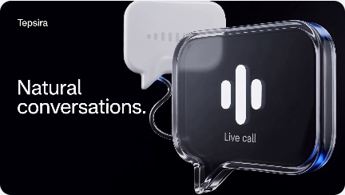
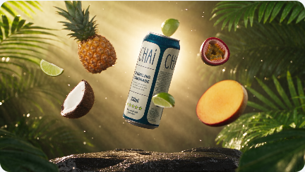
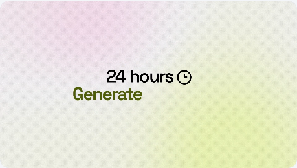
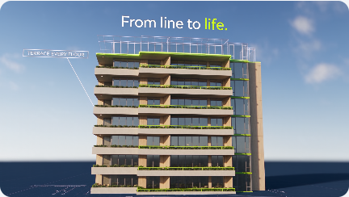
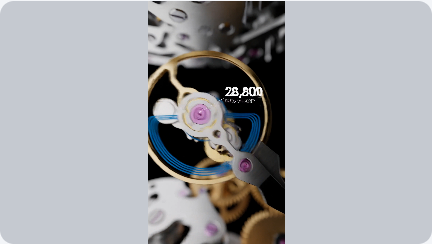
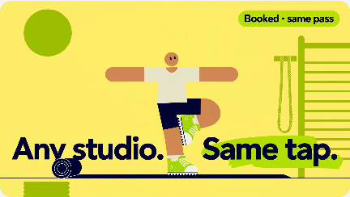
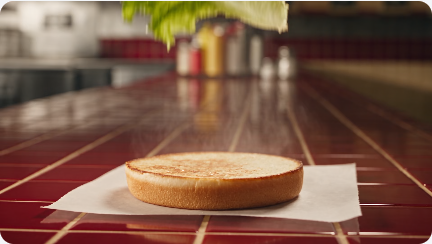
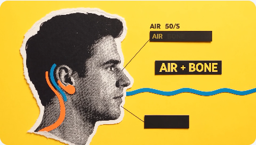
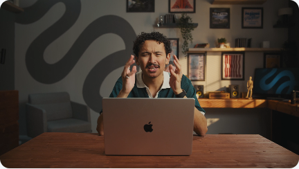

<div align="center">


# Shard

**Un estudio de motion design para vídeo e imágenes con IA, en tu propio ordenador.**

Planifica una película, genera sus escenas y termínala desde un estudio web, la terminal, o Claude Code y Codex.

[](https://github.com/AlexMakesC0de/motion-design/actions/workflows/validate.yml)
[](LICENSE)


[English](README.md) · [简体中文](README.zh-CN.md) · **Español** · [日本語](README.ja.md) · [한국어](README.ko.md) · [Português (Brasil)](README.pt-BR.md) · [Deutsch](README.de.md)

Esto es una traducción. Si difiere de la versión en inglés, la que cuenta es [README.md](README.md).

[Inicio rápido](#inicio-rápido) · [Créditos](#créditos) · [La CLI](cli/README.md) · [El servidor MCP](mcp/README.md) · [El estudio](web/README.md)

</div>

---

Shard nació como un fork de la **[skill motion-design de Chase](https://github.com/cth9191/motion-design)**, diez estilos de motion con muy buen aspecto y los prompts que hay detrás. Muchísimas gracias a Chase: los looks de este repositorio son suyos. Todo lo que está construido a su alrededor es nuevo. Mira los [Créditos](#créditos).

## Qué incluye

| Parte | Qué hace |
|---|---|
| **Estudio** (`web/`) | Una app web local: páginas de Imagen y Vídeo, películas planificadas escena por escena, una Biblioteca de personajes, productos y lugares, Looks, tus skills, gastos y ajustes. |
| **CLI `kie`** (`cli/`) | Genera vídeo, imágenes y audio con [kie.ai](https://kie.ai) (con WaveSpeed como alternativa), calcula el precio de cada trabajo antes de lanzarlo y guarda un registro de cada uno. |
| **Servidor MCP** (`mcp/`) | Da a Claude Code, Codex y Claude Desktop las mismas herramientas que el estudio, para que puedas hacer películas simplemente pidiéndolo. |
| **Render y acabado** (`render/`, `cli/`) | Dibuja con código los gráficos que tienen que ser exactos (títulos, logotipos, cifras) con Remotion, y termina las películas con ffmpeg: música, subtítulos, volumen, otras relaciones de aspecto. |
| **Biblioteca de skills** (`skills/`) | Tus skills de agente favoritas, cada una utilizable como `/slash-command`, como prompt MCP y en el estudio. `motion-design` contiene los looks. |

**El gasto está protegido en todas partes.** Cada trabajo de pago se presupuesta antes de enviarse y se comprueba contra un límite diario y un límite opcional por trabajo, venga del estudio, de la CLI o de un agente. Consultar, planificar y calcular precios es gratis.

## Inicio rápido

Necesitas **Node 20+** y una **clave de API de kie.ai**. ffmpeg solo hace falta para el acabado, y Python 3.10+ solo para reconstruir la galería de looks.

1. **Descarga el código e instala las herramientas.** El instalador añade `kie` a tu PATH, enlaza las skills con Claude Code, Codex y Kimi si están instalados, y registra el servidor MCP.

   ```bash
   git clone https://github.com/AlexMakesC0de/motion-design.git
   cd motion-design
   node install.mjs            # --dry-run shows what it would change first
   ```

2. **Añade tu clave de kie.ai**, legible solo por ti, y comprueba la configuración. `kie doctor` hace una consulta de saldo gratuita y no genera nada.

   ```bash
   mkdir -p ~/.config/kie
   printf '%s' 'YOUR_KIE_KEY' > ~/.config/kie/key && chmod 600 ~/.config/kie/key
   kie doctor
   ```

3. **Fija un presupuesto.** Por ejemplo, como máximo 25 USD al día y 2 USD por trabajo:

   ```bash
   kie limits --daily 25 --per-job 2
   ```

4. **Abre el estudio.** Funciona en http://127.0.0.1:4317 y solo responde a tu propio equipo.

   ```bash
   npm --prefix web install
   npm run studio
   ```

5. **O pídeselo a un agente.** Reinicia Claude Code o Codex y prueba: *"Planifica una película de producto de 15 segundos para mi app, enséñame el precio y no generes nada todavía."* La página MCP del estudio tiene el comando de configuración exacto para cada app.

## Haz algo desde la terminal

```bash
kie presets                                        # the ten looks
kie preflight --model seedance-2-5 --duration 10   # what a job would cost, without spending
kie video    --run launch --preset kinetic-typography --duration 10
kie render   --run launch --template logo-reveal --props brand.json
kie assemble --run launch --shot out.mp4 --shot logo-reveal.mp4 --transition fade:0.5
kie variants --run launch --video film.mp4 --ratios 9:16,1:1
```

El vídeo generado es fotográfico: inventa píxeles verosímiles. Todo lo que tiene que ser exacto, como un titular, un logotipo o un precio, es mejor dibujarlo con `kie render` y superponerlo a la película. [graphic-motion.md](skills/motion-design/references/graphic-motion.md) explica cuándo usar cada opción.

Tus películas, tomas y registros de gasto se quedan en `runs/`, y las referencias guardadas en `library/`. Git ignora ambas carpetas.

## Los looks

<!-- The gallery below is Chase's material, kept as he made it. -->
<p align="center"><sub>Los diez looks y estas vistas previas vienen del <a href="https://github.com/cth9191/motion-design">repositorio motion-design de Chase</a>. Haz clic en una imagen para reproducir su película original.</sub></p>

<table>
  <tr>
    <td width="33%" valign="top">
      <a href="https://d2ol7oe51mr4n9.cloudfront.net/user_3DiY2MbHSIvzM3FG2DOgC6Cf2MM/fee13558-1de4-46cb-80c6-443935cb8257.mp4"></a><br />
      <strong>Glass UI launch</strong><br />
      <sub>Lanzamientos de software y producto</sub>
    </td>
    <td width="33%" valign="top">
      <a href="https://d2ol7oe51mr4n9.cloudfront.net/user_3DiY2MbHSIvzM3FG2DOgC6Cf2MM/a95756c8-1f3f-4d93-9ea9-a14832aba4bd.mp4"></a><br />
      <strong>Tropical product</strong><br />
      <sub>Productos e ingredientes</sub>
    </td>
    <td width="33%" valign="top">
      <a href="https://d2ol7oe51mr4n9.cloudfront.net/user_3DiY2MbHSIvzM3FG2DOgC6Cf2MM/75a6c434-a18a-4484-81b0-387308743279.mp4"></a><br />
      <strong>Kinetic typography</strong><br />
      <sub>Anuncios y tipografía animada</sub>
    </td>
  </tr>
  <tr>
    <td width="33%" valign="top">
      <a href="https://d2ol7oe51mr4n9.cloudfront.net/user_3DiY2MbHSIvzM3FG2DOgC6Cf2MM/4e68af0a-c12e-4dd2-9f69-3b523e534ee4.mp4"></a><br />
      <strong>Blueprint to building</strong><br />
      <sub>Arquitectura e inmuebles</sub>
    </td>
    <td width="33%" valign="top">
      <a href="https://d2ol7oe51mr4n9.cloudfront.net/user_3DiY2MbHSIvzM3FG2DOgC6Cf2MM/9eb4a7a5-d79c-459a-8a8d-593e912aa7a3.mp4"></a><br />
      <strong>Exploded product</strong><br />
      <sub>Hardware y presentación de componentes</sub>
    </td>
    <td width="33%" valign="top">
      <a href="https://d2ol7oe51mr4n9.cloudfront.net/user_3DiY2MbHSIvzM3FG2DOgC6Cf2MM/eda55630-7def-48c7-b4a8-f73e6022b653.mp4"></a><br />
      <strong>Flat vector explainer</strong><br />
      <sub>Apps y explicaciones sencillas</sub>
    </td>
  </tr>
</table>

<details>
<summary><strong>Descubre cuatro estilos más</strong> — hipermovimiento, 2D + 3D híbrido, collage y metraje real</summary>

<table>
  <tr>
    <td width="50%" valign="top">
      <a href="https://d2ol7oe51mr4n9.cloudfront.net/user_3DiY2MbHSIvzM3FG2DOgC6Cf2MM/d1e752b7-ea6b-4553-98c6-15c8f3bf0cb4.mp4"></a><br />
      <strong>Product hyper-motion</strong><br />
      <sub>Comida y montaje de producto</sub>
    </td>
    <td width="50%" valign="top">
      <a href="https://d2ol7oe51mr4n9.cloudfront.net/user_3DiY2MbHSIvzM3FG2DOgC6Cf2MM/4d56be98-74fb-4616-9269-db37ea998171.mp4"></a><br />
      <strong>Hybrid 2D + 3D</strong><br />
      <sub>Historias de marca divertidas</sub>
    </td>
  </tr>
  <tr>
    <td width="50%" valign="top">
      <a href="https://d2ol7oe51mr4n9.cloudfront.net/user_3DiY2MbHSIvzM3FG2DOgC6Cf2MM/61a1f7e8-0a71-4f07-87de-8c75b4c69c34.mp4"></a><br />
      <strong>Editorial collage</strong><br />
      <sub>Ideas y cortos educativos</sub>
    </td>
    <td width="50%" valign="top">
      <a href="https://d2ol7oe51mr4n9.cloudfront.net/user_3DiY2MbHSIvzM3FG2DOgC6Cf2MM/d94bfad5-165f-4c27-ba85-bd169b1e3408.mp4"></a><br />
      <strong>Footage + graphics</strong><br />
      <sub>Presentadores y metraje existente</sub>
    </td>
  </tr>
</table>

</details>

## Créditos

- **Chase ([@cth9191](https://github.com/cth9191))** creó la skill original [motion-design](https://github.com/cth9191/motion-design) de la que nació este proyecto: los diez looks, sus prompts de origen, las guías de adaptación y las plantillas, la galería reproducible, las imágenes de vista previa y el wordmark "Motion Design". Gracias, Chase. Si te gustan los looks, ve a darle una estrella a su repositorio.
- Los prompts de origen aparecieron por primera vez en un [artículo de Higgsfield Marketing Studio](https://higgsfield.ai/@adilinthewildtempo/blogs/claude-fable-5-1-higgsfield-marketing-studio-300-day).
- Los iconos de marca de Claude y OpenAI en la página MCP son de [LobeHub Icons](https://github.com/lobehub/lobe-icons) (MIT).

[ATTRIBUTION.md](ATTRIBUTION.md) enumera exactamente qué archivos proceden del repositorio de Chase.

## Licencia

Todo lo que he escrito yo está bajo la [licencia MIT](LICENSE): el estudio, la CLI `kie`, el servidor MCP, los motores de render y acabado, el instalador, las guías de dirección, las pruebas y la documentación.

Los looks y el resto de archivos del repositorio de Chase **no** están cubiertos por la licencia MIT. Son suyos, y se comparten aquí con crédito; su repositorio no tiene licencia propia. [ATTRIBUTION.md](ATTRIBUTION.md) los enumera.

## Pruebas

```bash
npm test             # CLI
npm run test:mcp     # MCP server
npm run test:web     # studio
npm run validate     # the looks: source hashes, templates and gallery
```
