<div align="center">


# Shard

**A motion-design studio for AI video and images, on your own computer.**

Plan a film, generate its scenes and finish it, from a web studio, the terminal, or Claude Code and Codex.

[](https://github.com/AlexMakesC0de/shard-motion-design-studio/actions/workflows/ci.yml)
[](LICENSE)


**English** · [简体中文](README.zh-CN.md) · [Español](README.es.md) · [日本語](README.ja.md) · [한국어](README.ko.md) · [Português (Brasil)](README.pt-BR.md) · [Deutsch](README.de.md)

[Website](https://alexmakesc0de.github.io/shard-motion-design-studio/) · [A look around](#a-look-around) · [Quick start](#quick-start) · [Set up with an agent](#set-it-up-with-an-ai-agent) · [Credits](#credits) · [The CLI](cli/README.md) · [The MCP server](mcp/README.md) · [The studio](web/README.md)

</div>

---

Shard started as a fork of **[Chase's motion-design skill](https://github.com/cth9191/motion-design)**: ten motion styles with the prompts behind them, which live on here as the Ad templates. Thanks, Chase. The studio, the CLI, the MCP server, the 17 Looks and everything else were built for Shard. See [Credits](#credits).

## A look around

<p align="center">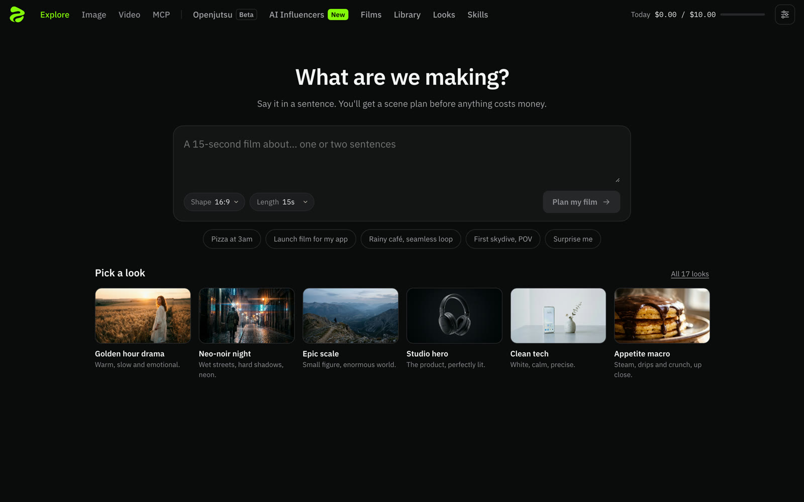</p>

<table>
  <tr>
    <td width="50%">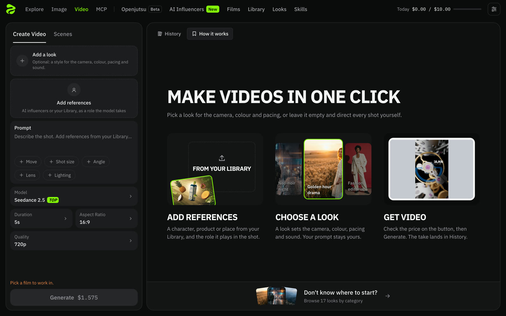<br><b>Video.</b> Pick a look, add references from your Library, see the price before you generate.</td>
    <td width="50%">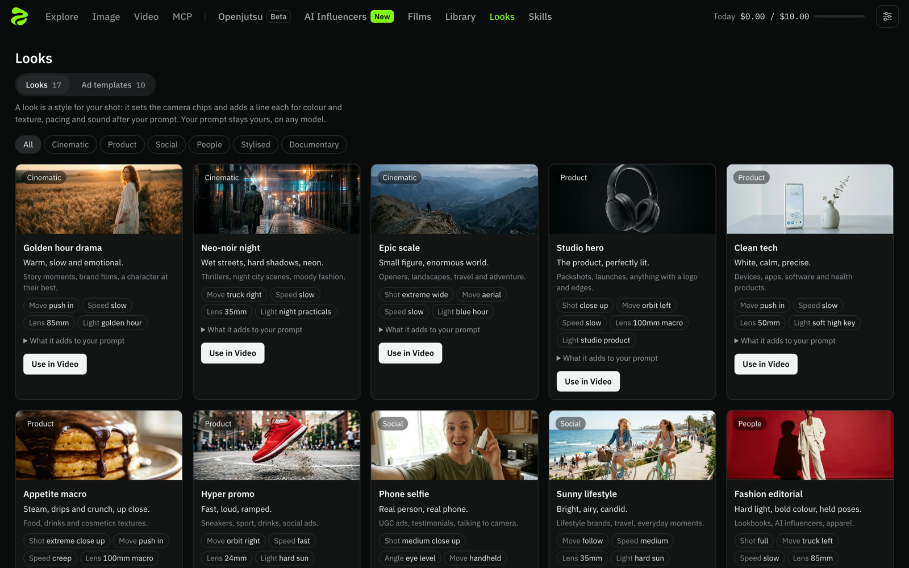<br><b>Looks.</b> 17 styles that set camera, colour, pacing and sound, on any model.</td>
  </tr>
  <tr>
    <td>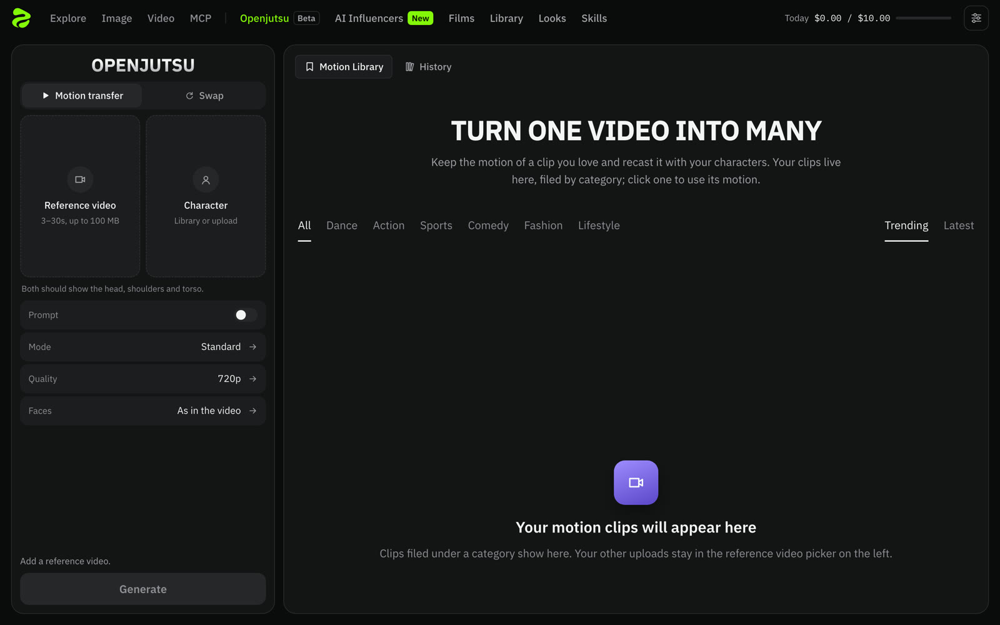<br><b>Openjutsu</b> (beta). Swap a person, outfit, object or background into a clip, from your own Motion Library.</td>
    <td>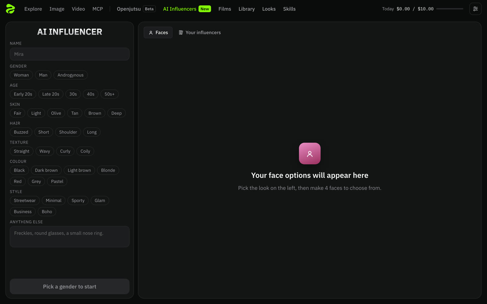<br><b>AI Influencers.</b> Build a face from a few choices, then a character sheet that keeps them the same everywhere.</td>
  </tr>
  <tr>
    <td>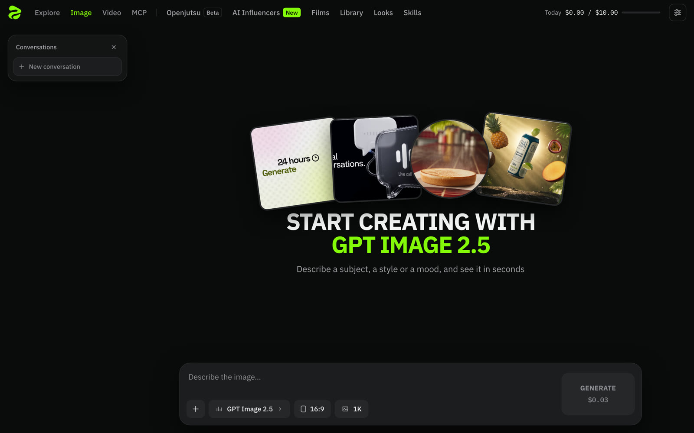<br><b>Image.</b> Pictures grouped into conversations, on GPT Image, Nano Banana and more.</td>
    <td>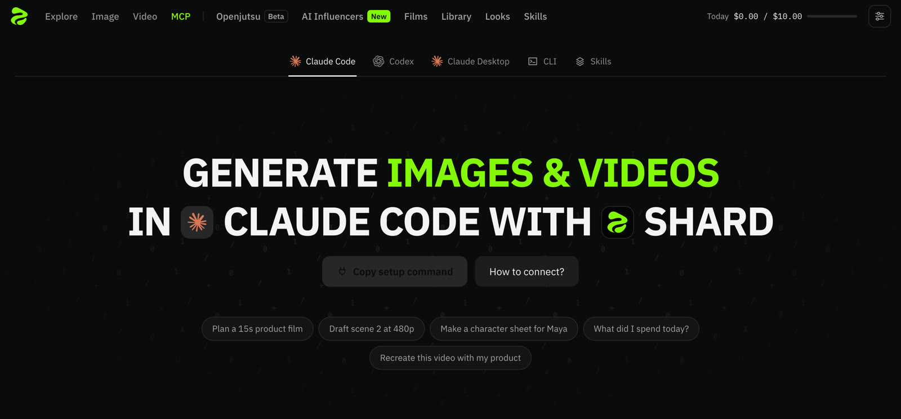<br><b>MCP.</b> The same tools in Claude Code, Codex and Claude Desktop, set up in one command.</td>
  </tr>
</table>

## What's inside

| Part | What it does |
|---|---|
| **Studio** (`web/`) | A local web app: Image and Video pages, films planned scene by scene, **Openjutsu** (beta: swap a person, outfit, object or background into any clip), **AI Influencers** with three-panel character sheets, a Library of characters, products and places, Looks, your skills, spend and settings. |
| **`kie` CLI** (`cli/`) | Generates video, images and audio through [kie.ai](https://kie.ai) (with WaveSpeed as a fallback), prices every job first, and keeps a record of each one. |
| **MCP server** (`mcp/`) | Gives Claude Code, Codex and Claude Desktop the same tools as the studio, so you can make films by asking. |
| **Render and finish** (`render/`, `cli/`) | Draws exact graphics in code (titles, logos, numbers) with Remotion, and finishes films with ffmpeg: music, captions, loudness, other aspect ratios. |
| **Skill library** (`skills/`) | Your favourite agent skills, each usable as a `/slash-command`, as an MCP prompt and in the studio. `motion-design` holds the looks. |

**Spending is guarded everywhere.** Every paid job is priced before it is sent and checked against a daily cap and an optional per-job limit, whether it comes from the studio, the CLI or an agent. Looking things up, planning and pricing are free.

## Quick start

You need **Node 22+** and a **kie.ai API key**. ffmpeg is needed only for finishing, and Python 3.10+ only to rebuild the looks gallery.

1. **Get the code and install the tools.** The installer puts `kie` on your PATH, links the skills into Claude Code, Codex and Kimi when they are installed, and registers the MCP server.

   ```bash
   git clone https://github.com/AlexMakesC0de/shard-motion-design-studio.git
   cd shard-motion-design-studio
   node install.mjs            # --dry-run shows what it would change first
   ```

2. **Add your kie.ai key**, readable only by you, then check the setup. `kie doctor` makes one free balance request and generates nothing.

   ```bash
   mkdir -p ~/.config/kie
   printf '%s' 'YOUR_KIE_KEY' > ~/.config/kie/key && chmod 600 ~/.config/kie/key
   kie doctor
   ```

3. **Set a budget.** For example, at most $25 a day and $2 per job:

   ```bash
   kie limits --daily 25 --per-job 2
   ```

4. **Open the studio.** It runs on http://127.0.0.1:4317 and only answers your own machine.

   ```bash
   npm --prefix web install
   npm run studio
   ```

5. **Or ask an agent.** Restart Claude Code or Codex and try: *"Plan a 15-second product film for my app, show me the price, and don't generate anything yet."* The MCP page in the studio has the exact setup command for each app.

## Set it up with an AI agent

Paste this into Claude Code, Codex or another coding agent with terminal access. It installs everything, checks it and opens the studio, and it is told not to spend anything.

```text
Set up Shard, the motion-design studio at https://github.com/AlexMakesC0de/shard-motion-design-studio, on this computer.

1. Check that Node 22 or newer is installed. If it isn't, tell me how to install it and stop.
2. Clone the repository into a folder I can find (ask me where if unsure), then cd into it.
3. Run `node install.mjs --dry-run`, show me what it would change, and wait for my OK. Then run `node install.mjs`.
4. Tell me to create a kie.ai API key at https://kie.ai and save it myself with:
   mkdir -p ~/.config/kie && printf '%s' 'MY_KEY' > ~/.config/kie/key && chmod 600 ~/.config/kie/key
   Never ask me to paste the key into this chat, and never read or print the key file.
5. When I say it's saved, run `kie doctor` (one free balance check, generates nothing) and show me the result.
6. Ask me for a daily spending limit and a per-job limit, then set them with `kie limits --daily <amount> --per-job <amount>`.
7. Run `npm --prefix web install`, then start the studio with `npm run studio` and give me the address (http://127.0.0.1:4317).
8. If ffmpeg is missing, tell me it's only needed for finishing films and how to install it; don't install it unasked.

Do not generate any image, video or audio, and do not spend money at any step. Finish with a short summary of what was installed and what I can try first.
```

## Make something from the terminal

```bash
kie looks                                          # the 17 Looks
kie presets                                        # the ten Ad templates
kie preflight --model seedance-2-5 --duration 10   # what a job would cost, without spending
kie video    --run launch --preset kinetic-typography --duration 10
kie render   --run launch --template logo-reveal --props brand.json
kie assemble --run launch --shot out.mp4 --shot logo-reveal.mp4 --transition fade:0.5
kie variants --run launch --video film.mp4 --ratios 9:16,1:1
```

Generated video is photographic: it invents plausible pixels. Anything that has to be exactly right, like a headline, a logo or a price, is better drawn by `kie render` and laid over the film. [graphic-motion.md](skills/motion-design/references/graphic-motion.md) explains when to use which.

Your films, takes and spend records stay in `runs/`, and saved references in `library/`. Both are ignored by git.

## The Looks

A Look sets the camera, light, colour, pacing and sound for a shot in one pick, on any video model. Shard ships 17, listed by `kie looks`, in the studio's Looks page and through MCP. The previews below were made for Shard.

<table>
  <tr>
    <td width="16%" valign="top"><br><sub>Golden hour drama</sub></td>
    <td width="16%" valign="top"><br><sub>Neo-noir night</sub></td>
    <td width="16%" valign="top">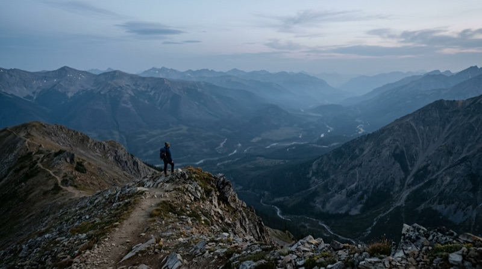<br><sub>Epic scale</sub></td>
    <td width="16%" valign="top">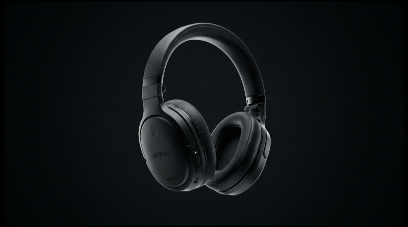<br><sub>Studio hero</sub></td>
    <td width="16%" valign="top">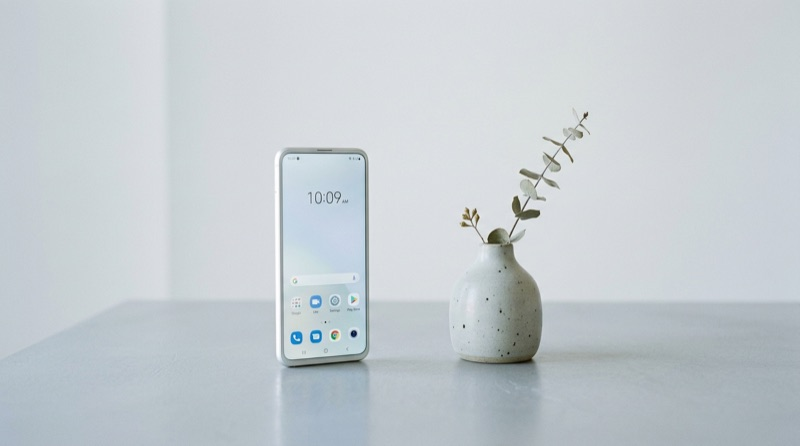<br><sub>Clean tech</sub></td>
    <td width="16%" valign="top"><br><sub>Appetite macro</sub></td>
  </tr>
  <tr>
    <td width="16%" valign="top">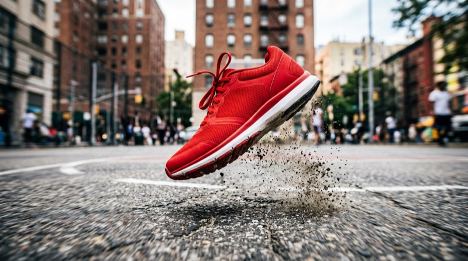<br><sub>Hyper promo</sub></td>
    <td width="16%" valign="top"><br><sub>Phone selfie</sub></td>
    <td width="16%" valign="top"><br><sub>Sunny lifestyle</sub></td>
    <td width="16%" valign="top"><br><sub>Vérité</sub></td>
    <td width="16%" valign="top">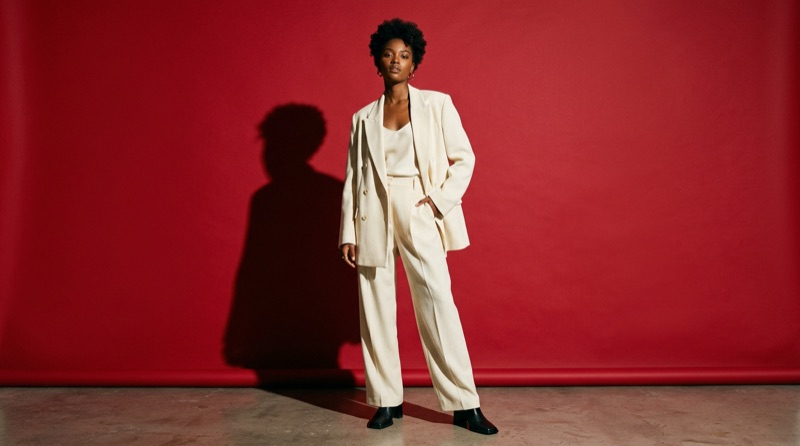<br><sub>Fashion editorial</sub></td>
    <td width="16%" valign="top"><br><sub>Intimate portrait</sub></td>
  </tr>
  <tr>
    <td width="16%" valign="top">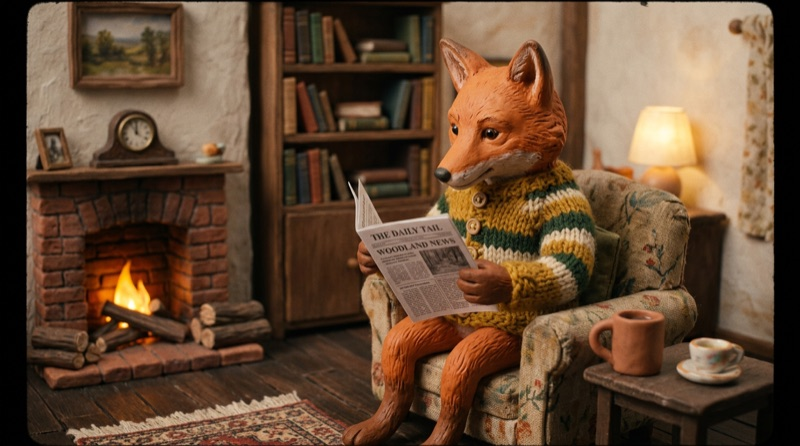<br><sub>Claymation</sub></td>
    <td width="16%" valign="top">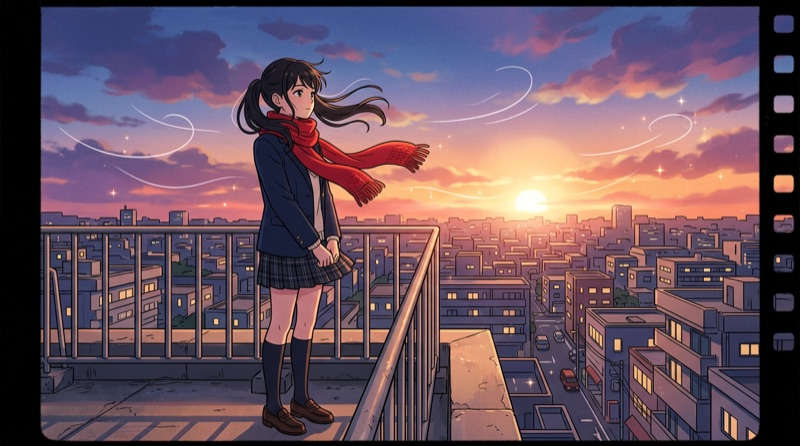<br><sub>Anime cel</sub></td>
    <td width="16%" valign="top"><br><sub>Soft 3D toon</sub></td>
    <td width="16%" valign="top">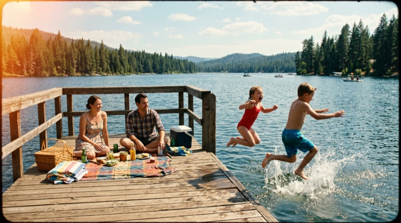<br><sub>Vintage 16mm</sub></td>
    <td width="16%" valign="top">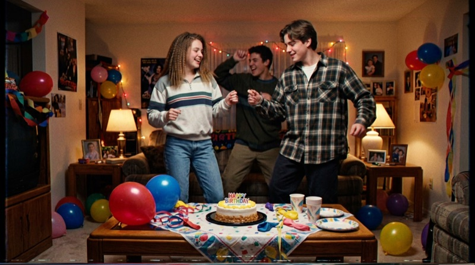<br><sub>Retro camcorder</sub></td>
  </tr>
</table>

Shard also keeps the ten **Ad templates** from Chase's original skill (`kie presets`): full source prompts with adaptation guides, for example a glass UI launch or an exploded product. They are his work and are not under the MIT licence; see [Licence](#licence).

## Credits

- **Chase ([@cth9191](https://github.com/cth9191))** made the original [motion-design](https://github.com/cth9191/motion-design) skill this project grew out of: the ten Ad templates, their source prompts and the adaptation guides. If you like them, give his repo a star.
- The Ad templates' source prompts first appeared in a [Higgsfield Marketing Studio article](https://higgsfield.ai/@adilinthewildtempo/blogs/claude-fable-5-1-higgsfield-marketing-studio-300-day).
- The Claude and OpenAI icons on the MCP page are from [LobeHub Icons](https://github.com/lobehub/lobe-icons) (MIT).

[ATTRIBUTION.md](ATTRIBUTION.md) lists exactly which files came from Chase's repo.

## Licence

Shard's own code and docs are under the [MIT licence](LICENSE): the studio, the `kie` CLI, the MCP server, the render and finishing engines, the installer, the Looks and their previews, the director guides, the tests and the docs.

The Ad templates and the other files from Chase's repo are **not** covered by the MIT licence. His repo has no licence, so they are his, included here with credit until he grants permission or they are replaced. [ATTRIBUTION.md](ATTRIBUTION.md) lists them. If you redistribute Shard, leave them out or ask him first.

## Tests

```bash
npm test             # CLI
npm run test:mcp     # MCP server
npm run test:web     # studio
npm run validate     # the Ad templates: source hashes, templates and gallery
```
