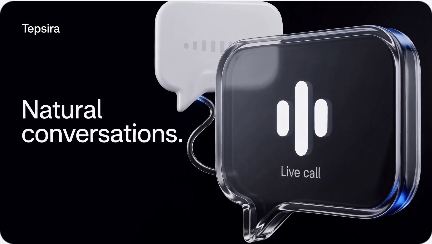
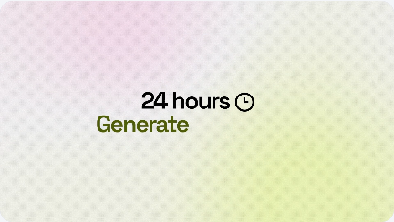
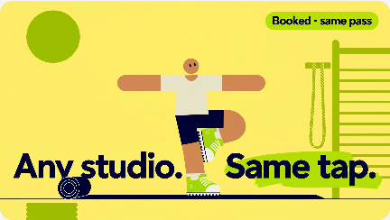
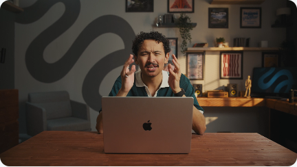

<div align="center">


# Shard

**A motion-design studio for AI video and images, on your own computer.**

Plan a film, generate its scenes and finish it, from a web studio, the terminal, or Claude Code and Codex.

[](https://github.com/AlexMakesC0de/shard-motion-design-studio/actions/workflows/validate.yml)
[](LICENSE)


**English** · [简体中文](README.zh-CN.md) · [Español](README.es.md) · [日本語](README.ja.md) · [한국어](README.ko.md) · [Português (Brasil)](README.pt-BR.md) · [Deutsch](README.de.md)

[Quick start](#quick-start) · [Credits](#credits) · [The CLI](cli/README.md) · [The MCP server](mcp/README.md) · [The studio](web/README.md)

</div>

---

Shard started as a fork of **[Chase's motion-design skill](https://github.com/cth9191/motion-design)**, ten great-looking motion styles with the prompts behind them. Huge thanks to Chase: the looks in this repo are his. Everything built around them is new. See [Credits](#credits).

## What's inside

| Part | What it does |
|---|---|
| **Studio** (`web/`) | A local web app: Image and Video pages, films planned scene by scene, a Library of characters, products and places, Looks, your skills, spend and settings. |
| **`kie` CLI** (`cli/`) | Generates video, images and audio through [kie.ai](https://kie.ai) (with WaveSpeed as a fallback), prices every job first, and keeps a record of each one. |
| **MCP server** (`mcp/`) | Gives Claude Code, Codex and Claude Desktop the same tools as the studio, so you can make films by asking. |
| **Render and finish** (`render/`, `cli/`) | Draws exact graphics in code (titles, logos, numbers) with Remotion, and finishes films with ffmpeg: music, captions, loudness, other aspect ratios. |
| **Skill library** (`skills/`) | Your favourite agent skills, each usable as a `/slash-command`, as an MCP prompt and in the studio. `motion-design` holds the looks. |

**Spending is guarded everywhere.** Every paid job is priced before it is sent and checked against a daily cap and an optional per-job limit, whether it comes from the studio, the CLI or an agent. Looking things up, planning and pricing are free.

## Quick start

You need **Node 20+** and a **kie.ai API key**. ffmpeg is needed only for finishing, and Python 3.10+ only to rebuild the looks gallery.

1. **Get the code and install the tools.** The installer puts `kie` on your PATH, links the skills into Claude Code, Codex and Kimi when they are installed, and registers the MCP server.

   ```bash
   git clone https://github.com/AlexMakesC0de/shard-motion-design-studio.git
   cd shard-motion-design-studio
   node install.mjs            # --dry-run shows what it would change first
   ```

2. **Add your kie.ai key**, readable only by you, then check the setup. `kie doctor` makes one free balance request and generates nothing.

   ```bash
   mkdir -p ~/.config/kie
   printf '%s' 'YOUR_KIE_KEY' > ~/.config/kie/key && chmod 600 ~/.config/kie/key
   kie doctor
   ```

3. **Set a budget.** For example, at most $25 a day and $2 per job:

   ```bash
   kie limits --daily 25 --per-job 2
   ```

4. **Open the studio.** It runs on http://127.0.0.1:4317 and only answers your own machine.

   ```bash
   npm --prefix web install
   npm run studio
   ```

5. **Or ask an agent.** Restart Claude Code or Codex and try: *"Plan a 15-second product film for my app, show me the price, and don't generate anything yet."* The MCP page in the studio has the exact setup command for each app.

## Make something from the terminal

```bash
kie presets                                        # the ten looks
kie preflight --model seedance-2-5 --duration 10   # what a job would cost, without spending
kie video    --run launch --preset kinetic-typography --duration 10
kie render   --run launch --template logo-reveal --props brand.json
kie assemble --run launch --shot out.mp4 --shot logo-reveal.mp4 --transition fade:0.5
kie variants --run launch --video film.mp4 --ratios 9:16,1:1
```

Generated video is photographic: it invents plausible pixels. Anything that has to be exactly right, like a headline, a logo or a price, is better drawn by `kie render` and laid over the film. [graphic-motion.md](skills/motion-design/references/graphic-motion.md) explains when to use which.

Your films, takes and spend records stay in `runs/`, and saved references in `library/`. Both are ignored by git.

## The looks

<!-- The gallery below is Chase's material, kept as he made it. -->
<p align="center"><sub>The ten looks and these previews come from <a href="https://github.com/cth9191/motion-design">Chase's motion-design repo</a>. Click an image to play its source film.</sub></p>

<table>
  <tr>
    <td width="33%" valign="top">
      <a href="https://d2ol7oe51mr4n9.cloudfront.net/user_3DiY2MbHSIvzM3FG2DOgC6Cf2MM/fee13558-1de4-46cb-80c6-443935cb8257.mp4"></a><br />
      <strong>Glass UI launch</strong><br />
      <sub>Software & product launches</sub>
    </td>
    <td width="33%" valign="top">
      <a href="https://d2ol7oe51mr4n9.cloudfront.net/user_3DiY2MbHSIvzM3FG2DOgC6Cf2MM/a95756c8-1f3f-4d93-9ea9-a14832aba4bd.mp4"></a><br />
      <strong>Tropical product</strong><br />
      <sub>Products & ingredients</sub>
    </td>
    <td width="33%" valign="top">
      <a href="https://d2ol7oe51mr4n9.cloudfront.net/user_3DiY2MbHSIvzM3FG2DOgC6Cf2MM/75a6c434-a18a-4484-81b0-387308743279.mp4"></a><br />
      <strong>Kinetic typography</strong><br />
      <sub>Announcements & animated type</sub>
    </td>
  </tr>
  <tr>
    <td width="33%" valign="top">
      <a href="https://d2ol7oe51mr4n9.cloudfront.net/user_3DiY2MbHSIvzM3FG2DOgC6Cf2MM/4e68af0a-c12e-4dd2-9f69-3b523e534ee4.mp4"></a><br />
      <strong>Blueprint to building</strong><br />
      <sub>Architecture & property</sub>
    </td>
    <td width="33%" valign="top">
      <a href="https://d2ol7oe51mr4n9.cloudfront.net/user_3DiY2MbHSIvzM3FG2DOgC6Cf2MM/9eb4a7a5-d79c-459a-8a8d-593e912aa7a3.mp4"></a><br />
      <strong>Exploded product</strong><br />
      <sub>Hardware & component reveals</sub>
    </td>
    <td width="33%" valign="top">
      <a href="https://d2ol7oe51mr4n9.cloudfront.net/user_3DiY2MbHSIvzM3FG2DOgC6Cf2MM/eda55630-7def-48c7-b4a8-f73e6022b653.mp4"></a><br />
      <strong>Flat vector explainer</strong><br />
      <sub>Apps & simple explanations</sub>
    </td>
  </tr>
</table>

<details>
<summary><strong>Explore four more styles</strong> — hyper-motion, hybrid 2D + 3D, collage and footage</summary>

<table>
  <tr>
    <td width="50%" valign="top">
      <a href="https://d2ol7oe51mr4n9.cloudfront.net/user_3DiY2MbHSIvzM3FG2DOgC6Cf2MM/d1e752b7-ea6b-4553-98c6-15c8f3bf0cb4.mp4"></a><br />
      <strong>Product hyper-motion</strong><br />
      <sub>Food & product assembly</sub>
    </td>
    <td width="50%" valign="top">
      <a href="https://d2ol7oe51mr4n9.cloudfront.net/user_3DiY2MbHSIvzM3FG2DOgC6Cf2MM/4d56be98-74fb-4616-9269-db37ea998171.mp4"></a><br />
      <strong>Hybrid 2D + 3D</strong><br />
      <sub>Playful brand stories</sub>
    </td>
  </tr>
  <tr>
    <td width="50%" valign="top">
      <a href="https://d2ol7oe51mr4n9.cloudfront.net/user_3DiY2MbHSIvzM3FG2DOgC6Cf2MM/61a1f7e8-0a71-4f07-87de-8c75b4c69c34.mp4"></a><br />
      <strong>Editorial collage</strong><br />
      <sub>Ideas & educational shorts</sub>
    </td>
    <td width="50%" valign="top">
      <a href="https://d2ol7oe51mr4n9.cloudfront.net/user_3DiY2MbHSIvzM3FG2DOgC6Cf2MM/d94bfad5-165f-4c27-ba85-bd169b1e3408.mp4"></a><br />
      <strong>Footage + graphics</strong><br />
      <sub>Presenters & existing footage</sub>
    </td>
  </tr>
</table>

</details>

## Credits

- **Chase ([@cth9191](https://github.com/cth9191))** made the original [motion-design](https://github.com/cth9191/motion-design) skill this project grew out of: the ten looks, their source prompts, the adaptation guides and templates, the playable gallery, the preview stills and the "Motion Design" wordmark. Thank you, Chase. If you like the looks, go give his repo a star.
- The source prompts first appeared in a [Higgsfield Marketing Studio article](https://higgsfield.ai/@adilinthewildtempo/blogs/claude-fable-5-1-higgsfield-marketing-studio-300-day).
- Brand icons for Claude and OpenAI on the MCP page are from [LobeHub Icons](https://github.com/lobehub/lobe-icons) (MIT).

[ATTRIBUTION.md](ATTRIBUTION.md) lists exactly which files came from Chase's repo.

## Licence

Everything I wrote is under the [MIT licence](LICENSE): the studio, the `kie` CLI, the MCP server, the render and finishing engines, the installer, the director guides, the tests and the docs.

The looks and the other files from Chase's repo are **not** covered by the MIT licence. They are his, shared here with credit, and his repo has no licence of its own. [ATTRIBUTION.md](ATTRIBUTION.md) lists them.

## Tests

```bash
npm test             # CLI
npm run test:mcp     # MCP server
npm run test:web     # studio
npm run validate     # the looks: source hashes, templates and gallery
```
